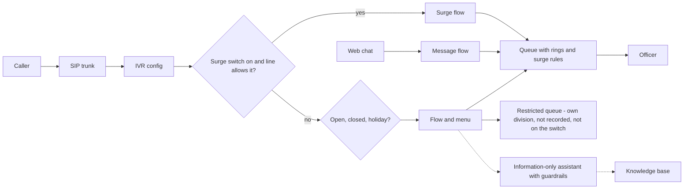

# genesys-citizen-services-style-lab

A design-and-code study: a public contact centre in the style of a national government agency, built on **Genesys Cloud CX** as Terraform ("CX as Code"), with AI guardrails, a restricted division, separation of duties, quality, recording retention, workforce management, a governance pack and documentation written for review.

It is the Genesys counterpart to my [AWS enterprise bank lab](https://github.com/asvinluan/aws-enterprise-bank-lab), and a sibling of [genesys-health-style-lab](https://github.com/asvinluan/genesys-health-style-lab): the same modules, a different design file.

> **Status: lab and design.** The Terraform passes `validate` against the real `mypurecloud/genesyscloud` provider schema (v1.87.1) and an **offline plan test** with the provider mocked (4 scenarios). It has **not been applied to a live org**, and the flow YAML has **not** been checked with Archy. The code was drafted with AI assistance and reviewed by me. This is **not** any real agency, not a production system and not a claim of production experience. Public information only. See [what is not built](docs/BUILD-MANUAL.md#part-14-what-is-not-built-yet).

## What it models

| Area | What is in the repo |
|---|---|
| Foundation | 4 divisions (one restricted), 16 groups, 6 roles with separation of duties, skills, languages, wrap-up codes |
| Telephony | BYOC Cloud site, SIP trunk shell (A-law), DID pool, emergency location |
| Routing | Schedules, holidays, 9 queues with bullseye rings, service-level targets and surge rules by estimated wait |
| Architect | 9 flow templates (YAML), 4 number-to-flow configs, data tables, a per-line surge switch |
| Integrations | Least-privilege OAuth client, data actions, a tested Node.js function that accepts a reference number only |
| AI | Knowledge base, agentic virtual agent with custom guardrails, speech and text analytics, summaries |
| Quality | Evaluation form with critical and kill questions, survey, retention policy, WFM business unit |
| Digital | Web messaging limited to allowed domains, optional SSO |
| Security | Optional organisation-wide sign-in hardening (MFA, idle timeout, password rules, IP allow-list) |
| Governance | Draft AI register entry, impact assessment outline, transparency statement notes, compliance map |
| Operations | Health-check script (bash and PowerShell), operations and on-call guide, RCA and knowledge templates |

## Architecture



## AI guardrails, in one table

| Layer | Genesys feature used | Bedrock equivalent |
|---|---|---|
| Scope | Agent role and instructions | System prompt |
| Input rules | Custom guardrail rules | Denied topics |
| Grounding | Knowledge-base-only tool | Contextual grounding check |
| Data protection | Instruction to refuse identity or health details, PII redaction | Sensitive information filters |
| Violations | Guardrails event with a violation threshold | Blocked-message handling |
| Human | Escalation event and transfer | (flow logic) |
| Monitoring | Speech and text analytics, quality evaluation | CloudWatch, invocation logs |
| Accountability | `governance/` pack | (not applicable) |

## Run it

No Genesys org, client ID or secret is needed for this. One script does the offline steps (function tests, init and validate, the offline plan test, the repo safety check):

```powershell
.\scripts\powershell\offline-check.ps1      # Windows PowerShell 5.1 or PowerShell 7
```

```bash
./scripts/bash/offline-check.sh              # Windows (Git Bash or MSYS2), Linux, macOS, WSL
```

Step by step, with the install commands: [RUNBOOK-OFFLINE-POWERSHELL](docs/RUNBOOK-OFFLINE-POWERSHELL.md) or [RUNBOOK-OFFLINE-BASH](docs/RUNBOOK-OFFLINE-BASH.md).

To build in a **lab** org, follow [docs/BUILD-MANUAL.md](docs/BUILD-MANUAL.md) and one runbook ([PowerShell](docs/RUNBOOK-POWERSHELL.md) or [Bash](docs/RUNBOOK-BASH.md)). **Never run it against a customer or government org.**

## Documents

| Document | Purpose |
|---|---|
| [ARCHITECTURE](docs/ARCHITECTURE.md) | Why it is built this way, AWS-to-Genesys mapping, AI guardrails |
| [BUILD-MANUAL](docs/BUILD-MANUAL.md) | How to build it, step by step |
| [RUNBOOK-OFFLINE-POWERSHELL](docs/RUNBOOK-OFFLINE-POWERSHELL.md) / [RUNBOOK-OFFLINE-BASH](docs/RUNBOOK-OFFLINE-BASH.md) | Everything that needs no org, client ID or secret |
| [RUNBOOK-POWERSHELL](docs/RUNBOOK-POWERSHELL.md) / [RUNBOOK-BASH](docs/RUNBOOK-BASH.md) | Exact commands against a lab org (needs an OAuth client) |
| [OPERATIONS-AND-ON-CALL](docs/OPERATIONS-AND-ON-CALL.md) | Daily routine, severity, incidents, RCA, change, knowledge |
| [COST-AND-CLEANUP](docs/COST-AND-CLEANUP.md) | Where cost hides, how to clean up |
| [governance/](governance/) | AI register entry, impact assessment outline, statement notes, compliance map |

## What was found by testing (and fixed)

- Genesys needs **at least two bullseye rings** and the last is "everyone": the routing module now builds that from a simple list.
- Queue **service level is a fraction** (0 to 1), not a percentage: the module divides by 100.
- `validate` cannot see inside loops. The **offline plan test** can, and that is how both were found.

## Licence

MIT. Phone numbers are in the range Australia reserves for TV and film (03 5550 xxxx). Nothing here is real government data or design.
